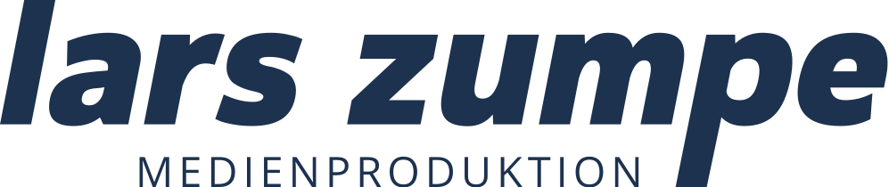
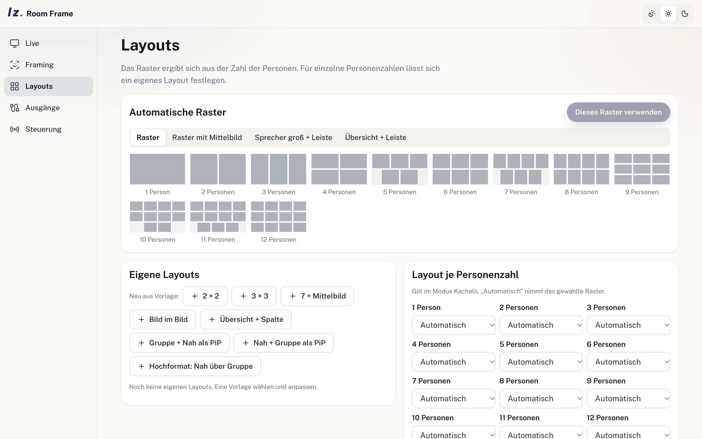

<p align="center">
  <picture>
    <source media="(prefers-color-scheme: dark)" srcset="docs/brand/lzm_hauptlogo_offwhite.svg" />
    
  </picture>
</p>

<h1 align="center">LZ Room Frame</h1>

<p align="center">
  <b>Multi-Personen-Framing für Meetingräume – macOS, Windows und Linux.</b><br />
  Jede Kamera rein, jede Person in eine eigene Kachel, raus an Zoom, Teams, NDI, einen Stream oder einen ATEM.
</p>

<p align="center">
  <a href="https://github.com/larszu/lz-room-frame/releases/latest">
    
  </a>
</p>

<p align="center">
  <picture>
    <source media="(prefers-color-scheme: dark)" srcset="docs/screenshots/layouts-dark.png" />
    
  </picture>
</p>

<p align="center"><a href="README.md">English</a></p>

---

## Warum LZ Room Frame


- **Jeder Eingang, jede Auflösung:** USB/UVC-Kameras, HDMI- und SDI-Capture-Karten, IP- und PTZ-Kameras per RTSP/SRT/RTMP, Videodateien. Die App fordert das Maximum des Geräts an; das Ausgabeformat ist frei (16:9, 9:16, quadratisch, 4K …).
- **Framing wie bei KI-PTZ-Kameras:** Modi *Übersicht, Gruppe, Kacheln, Sprecher, Präsentator*. Dazu kommen Bildgrößen von Nah bis Halbtotale, Kopfluft, Rand um die Gruppe, Ruhezone, Geschwindigkeit und Übergang (weich, Blende, Schnitt). Außerdem eine Haltezeit und eine Schärfegrenze, die das Kamerabild nie über einen festen Faktor vergrößert.
- **Raster nach Personenzahl:** Raster, Raster mit Mittelbild (wie „7 Kacheln mit Übersicht"), Sprecher groß mit Leiste, Übersicht mit Leiste. Eigene Layouts zeichnet man auf einem 12 × 12-Raster. Man legt sie je Personenzahl oder fest pro Szene fest, z. B. *Gruppe groß + Nahaufnahme als Bild im Bild*.
- **Raum:** Raumgrenze, Ausschlusszonen (Glaswand, Tür, Bildschirme) und eine Mindestkopfgröße.
- **Sprecher:** kommen vom Audiosystem (Sprecherzonen, geschaltet von Q-SYS-Automixer-Gates, Crestron oder Tischmikrofonen). Oder von einem einzelnen Audioeingang: Kameraton über die Capture-Karte (z. B. DSLM per HDMI), USB-Audio, Klinke. *Mono:* Spracherkennung plus Lippenbewegung. *Stereo:* zusätzlich die Richtung aus Pegel- und Laufzeitunterschied (GCC-PHAT), mit Zwei-Punkt-Kalibrierung auf das Bild. Eine Mono-Quelle mit zwei gleichen Kanälen wird erkannt.
- **Zweite Ausgabe (B):** ein zweites Bild aus derselben Kamera mit eigener Größe und Szene, z. B. 9:16.
- **PTZ-Auto-Tracking:** Die Erkennung steuert eine echte PTZ-Kamera per VISCA (Sony VISCA over IP UDP 52381, VISCA TCP/UDP).
- **ATEM:** Eine SuperSource-Box zeigt die Kamera auf die Hauptperson beschnitten und folgt ihr. Die Tracking-Daten gibt es zusätzlich als `TRK`-Zeilen und über `GET /api/tracking`.
- **Ausgänge:** Vollbildfenster auf jedem Bildschirm oder HDMI-Ausgang, NDI (A und B), Stream per RTMP/SRT/RTSP/UDP und unter Linux v4l2loopback. Zoom, Teams und Meet bekommen das Bild über NDI Virtual Input (Mac) bzw. NDI Webcam Input (Windows).
- **Steuerung:** TCP 4198 (ein Befehl pro Zeile), HTTP und WebSocket auf 4197, eine Web-Fernbedienung für Touchpanels. Dazu ein Q-SYS-Plugin und Crestron-Beispiele (`docs/integrations`).
- **Raumrechner:** Die App startet mit dem System, auf Wunsch versteckt im Tray, und öffnet Eingang, Szene und Ausgänge wieder.

Die Erkennung läuft lokal in einem Worker: RTMO-s findet Personen samt Körperpunkten, so wird der Kopf auch bei halbem Gesicht am Bildrand, im Profil und von hinten gefunden. OSNet erkennt eine Person wieder, die zurückkommt (gleiche Kachel, gleicher Name). ONNX Runtime mit WebGPU, CPU-Rückfall. Es ist keine Cloud beteiligt.

## Aus dem Quellcode bauen

```sh
npm install
npm run dev          # Vite auf 4196 + Electron
npm test
npm run dist:mac     # bzw. dist:win / dist:linux
```

NDI braucht auf dem Zielrechner die kostenlose NDI-Runtime (ndi.video).

## Stand

Geprüft unter macOS (Apple Silicon) mit einer Videodatei:
- Erkennung, alle Raster, Szenen und Programm B
- NDI A und B, mit einem NDI-Empfänger gegengeprüft
- UDP-Stream und Steuerung per TCP und HTTP
- VISCA-Pakete an einem UDP-Empfänger

**Noch nicht geprüft:**
- echte Kameras und Capture-Karten
- echte PTZ-Kamera und echter ATEM
- Q-SYS-Plugin in Designer und Crestron
- Builds für Windows und Linux

## Lizenz

Proprietär, kostenlos nutzbar: Die veröffentlichten Builds dürfen kostenlos genutzt werden, auch geschäftlich. Der Quellcode ist öffentlich, aber nicht Open Source – siehe [LICENSE](LICENSE). Komponenten Dritter: [THIRD-PARTY-LICENSES.md](THIRD-PARTY-LICENSES.md).

NDI® ist eine eingetragene Marke der Vizrt NDI AB. ATEM ist eine Marke von Blackmagic Design.
