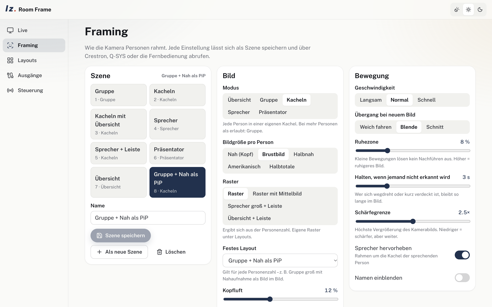
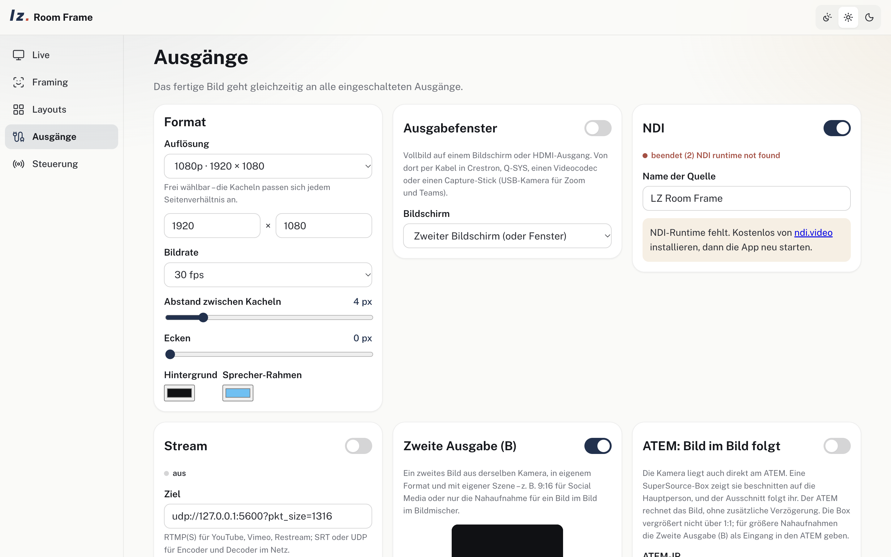

<p align="center">
  <picture>
    <source media="(prefers-color-scheme: dark)" srcset="docs/brand/lzm_hauptlogo_offwhite.svg" />
    
  </picture>
</p>

<h1 align="center">LZ Room Frame</h1>

<p align="center">
  <b>Multi-person framing for meeting rooms – macOS, Windows and Linux.</b><br />
  Any camera in, every person in their own tile, out to Zoom, Teams, NDI, a stream or an ATEM.
</p>

<p align="center">
  <a href="https://github.com/larszu/lz-room-frame/releases/latest">
    
  </a>
</p>

<p align="center">
  <picture>
    <source media="(prefers-color-scheme: dark)" srcset="docs/screenshots/layouts-dark.png" />
    
  </picture>
</p>

<p align="center"><a href="README.de.md">Deutsch</a></p>

---

## Why LZ Room Frame


- **Any input, any resolution:** USB/UVC cameras, HDMI and SDI capture cards, IP and PTZ cameras over RTSP/SRT/RTMP, video files. The app asks for the most the device offers; output size is free (16:9, 9:16, square, 4K …).
- **Framing like AI PTZ cameras:** modes *overview, group, tiles, speaker, presenter*; shot sizes from close-up to wide; headroom, group margin, dead band, speed, transition (smooth, fade, cut), hold time and a sharpness guard that never enlarges the camera picture beyond a set factor.
- **Layouts that follow the head count:** grid, grid with centre overview (as in the "7 tiles with centre view"), speaker large with strip, overview with strip. Custom layouts can be drawn on a 12 × 12 grid and assigned to a head count or fixed per scene, e.g. *group large + close-up as picture-in-picture*.
- **Room:** room boundary, exclusion zones (glass walls, doors, screens) and a minimum head size.
- **Speaker:** from the room's audio system (speaker zones switched by Q-SYS automixer gates, Crestron, seat mics), or from any single audio input – the camera's own sound through a capture card (e.g. a mirrorless camera over HDMI), USB audio, a 3.5 mm jack. *Mono:* voice activity plus lip movement. *Stereo:* adds the direction from level and time difference (GCC-PHAT), with a two-point calibration onto the picture. A mono source sent as two equal channels is detected.
- **Second output (B):** a second picture from the same camera with its own size and scene, e.g. 9:16 for social media.
- **PTZ auto-tracking:** detection steers a real PTZ camera over VISCA (Sony VISCA over IP UDP 52381, VISCA TCP/UDP).
- **ATEM:** a SuperSource box shows the camera cropped to the main person and follows them. Tracking data are also available as `TRK` lines and `GET /api/tracking`.
- **Outputs:** fullscreen window on any display or HDMI out, NDI (A and B), RTMP/SRT/RTSP/UDP stream, Linux v4l2loopback. Zoom/Teams/Meet run through NDI Virtual Input (Mac) or NDI Webcam Input (Windows).
- **Control:** TCP 4198 (one command per line), HTTP and WebSocket 4197, a web remote for touch panels, a Q-SYS plugin and Crestron examples (`docs/integrations`).
- **Room PC:** start with the system, start hidden in the tray, and come back with the last input, scene and outputs.

Detection runs locally in a worker (MediaPipe EfficientDet-Lite0 + BlazeFace, GPU with CPU fallback). No cloud is involved.

## Screenshots

| Framing | Outputs |
|---|---|
| <picture><source media="(prefers-color-scheme: dark)" srcset="docs/screenshots/framing-dark.png" /></picture> | <picture><source media="(prefers-color-scheme: dark)" srcset="docs/screenshots/outputs-dark.png" /></picture> |

## Control protocol

```
scene 2 | scene Gruppe        mode overview|group|people|speaker|presenter
style grid|center|speaker|strip   shot close|mcu|medium|cowboy|wide   speed slow|normal|fast
privacy on|off   freeze on|off   speaker 3|none   zone 2 on|off   presenter 1|auto
sceneb 4   output window|ndi|stream|v4l2|b|ndib|windowb on|off   ptz on|off
status   scenes   subscribe on   tracking on   help
```

HTTP: `GET /api/command?c=scene%201`, `POST /api/command`, `GET /api/status`, `GET /api/scenes`, `GET /api/tracking`, `GET /preview.mjpg`.

## Build from source

```sh
npm install
npm run dev          # Vite on 4196 + Electron
npm test             # unit tests (tracker, framing, layouts, director, commands, PTZ, ATEM)
npm run dist:mac     # or dist:win / dist:linux – builds the NDI helper and the installer
```

NDI needs the free NDI runtime (ndi.video) on the target machine; LZ Room Frame does not ship it.

## Status

Tested on macOS (Apple Silicon) with a video file: detection, all layouts, scenes, programme B, NDI A/B (received with an NDI receiver), UDP stream, TCP/HTTP control and VISCA packets (checked on a UDP listener). **Not tested yet:** real cameras and capture cards, a real PTZ camera, a real ATEM, the Q-SYS plugin in Designer, Crestron, Windows and Linux builds.

## Author & support

Lars Zumpe Medienproduktion · [zumpelars.de](https://zumpelars.de) · bugs and ideas: [issues](https://github.com/larszu/lz-room-frame/issues).

## License

Proprietary, free to use: the released builds may be used free of charge, also commercially; the source code is public but not open source – see [LICENSE](LICENSE). Third-party components: [THIRD-PARTY-LICENSES.md](THIRD-PARTY-LICENSES.md).

NDI® is a registered trademark of Vizrt NDI AB. ATEM is a trademark of Blackmagic Design.
